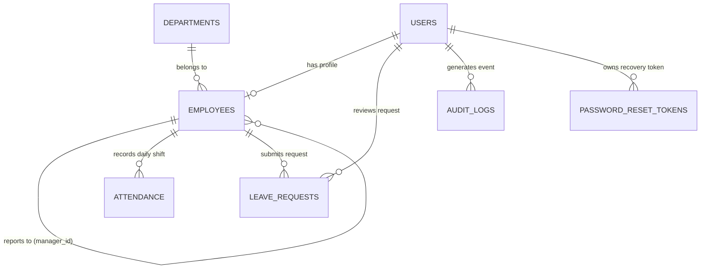

# Cruvels Ltd. — Employee Management System

[](http://localhost:5173)
[](npm-test)
[](frontend)
[](docs/API.md)
[](docs/er-diagram.md)

Cruvels Ltd. Employee Management System (Option D) is a full-stack, enterprise-grade Workforce Operations & Resource Management Platform. Engineered with a hardened Node.js/PostgreSQL backend, multi-role RBAC, immutable security audit logging, cryptographic single-use expiring password recovery, concurrent session protection, and an asymmetric, human-crafted React 19 / Vite frontend conforming to the Cruvels SaaS Design Token system.

---

## Table of Contents

1. [Overview](#overview)
2. [Features](#features)
3. [User Roles](#user-roles)
4. [Core Workflows](#core-workflows)
5. [Screens / Modules](#screens--modules)
6. [Technology Stack](#technology-stack)
7. [System Architecture](#system-architecture)
8. [Database Design](#database-design)
9. [Authentication & Authorization](#authentication--authorization)
10. [API Documentation](#api-documentation)
11. [Project Structure](#project-structure)
12. [Prerequisites](#prerequisites)
13. [Installation](#installation)
14. [Environment Variables](#environment-variables)
15. [Database Setup](#database-setup)
16. [Seed Data](#seed-data)
17. [Running the Application](#running-the-application)
18. [Running Tests](#running-tests)
19. [Test Results](#test-results)
20. [Demo Credentials](#demo-credentials)
21. [Known Limitations](#known-limitations)
22. [Future Improvements](#future-improvements)
23. [Security Considerations](#security-considerations)
24. [License](#license)

---

## Overview

Modern workforce platforms frequently fail on three core requirements: role leakage, insecure session management, and generic copy-paste user interfaces. Cruvels Ltd. was built from the ground up to solve these challenges:

- **Strict Role Isolation:** Employees, Managers, and System Admins operate in distinct permission domains enforced at both the client routing boundary and the database query layer.
- **Single-Session Integrity:** Concurrent logins across multiple tabs or physical devices are detected immediately via PostgreSQL token versioning and browser `BroadcastChannel` events, triggering interactive warning modals.
- **Enterprise Resiliency:** Features an append-only immutable audit trail, automated AES-256-GCM database snapshot encryption, sliding IP rate limiting, and zero plaintext credentials.
- **Human-Crafted Polish:** Custom Geist and Inter typography, smooth capsule geometry (`rounded-full`), zero cumulative layout shift (CLS), and responsive layouts tailored from 375px mobile to 1920px 4K monitors.

---

## Features

- **Personal Workforce Desk:** Real-time shift status, daily punch-in/out timers, attendance distribution meters, and personal leave balances.
- **Shift & Attendance Tracking:** Idempotent daily shift attendance with automatic timestamping, late-arrival classification, and chronological logs.
- **Time Off & Leave Engine:** Self-service leave request submission with date-overlap validation, leave balance calculation, and manager approval queues.
- **Manager Review Desk:** Direct-report roster management, team shift records, and single-click approval or rejection with reason logging.
- **Administrative Control Panel:** Full organizational CRUD for employees, department structure management, headcount analytics, and security audit log inspection.
- **Security & Multi-Factor Auth:** Time-based One-Time Password (TOTP / RFC 6238) two-factor authentication with QR code generation and emergency backup codes.
- **Single Sign-On (SSO):** Integrated SSO entry points for Google, Microsoft 365, and Enterprise SAML/Okta gateways.
- **Company Vibe & Watercooler Bulletin:** Integrated office social board for announcements, birthdays, and culture building.

---

## User Roles

Cruvels enforces three strictly delineated user roles:

### Employee
- Accesses personal **My Desk** overview.
- Logs daily shift attendance (Punch In / Punch Out).
- Submits time-off requests across CASUAL, SICK, PAID, and UNPAID categories.
- Views personal shift and leave approval history.
- Manages personal profile and two-factor authentication.
- Explicitly blocked (403 Forbidden) from administrative APIs and directory modifications.

### Manager
- All employee operational capabilities for their own personal desk.
- Accesses **Team Operations** displaying assigned direct reports.
- Inspects shift attendance records for their managed team.
- Reviews, approves, or rejects pending leave requests submitted by their direct reports.
- Blocked from company-wide IT administration or altering other managers' reports.

### Admin
- Global workspace executive view.
- Complete employee directory lifecycle (create, edit, soft-delete, deactivate).
- Creates and removes organizational departments.
- Company-wide shift roster and leave management across all departments.
- Full access to the **Security Trail (`/audit-logs`)** inspecting actor IPs, logins, and permission changes.

---

## Core Workflows

### 1. Daily Attendance Lifecycle
```text
Employee logs in
  └─► Navigates to My Desk or My Shifts
        └─► Clicks "Punch In" (Records timestamp & checks late threshold)
              └─► Completes daily shift duties
                    └─► Clicks "Punch Out" (Updates record with end timestamp)
```

### 2. Time Off Application & Review
```text
Employee submits Leave Request (e.g., Casual Leave, 2 days, Reason)
  └─► System validates no overlapping active leaves
        └─► Request status set to PENDING
              └─► Manager reviews on Leave Approvals desk
                    ├─► Approve ──► Status: APPROVED (Notification dispatched)
                    └─► Reject  ──► Status: REJECTED (Reason captured)
```

### 3. Concurrent Session Detection
```text
User signs in on Tab A (Token Version N)
  └─► Same user signs in on Tab B or Device B (Token Version increments to N+1)
        ├─► BroadcastChannel alerts Tab A immediately (0ms delay)
        ├─► Heartbeat / API call on Tab A receives 401 CONCURRENT_LOGIN_LOGOUT
        └─► Interactive modal prompts user to return to login
```

---

## Screens / Modules

| Screen | Route | Role | Description |
| :--- | :--- | :---: | :--- |
| **Landing Page** | `/` | Public | Marketing hero, core platform value pillars, and entry portal |
| **Sign In** | `/login` | Public | Credential input, SSO buttons, and session termination handler |
| **Sign Up** | `/signup` | Public | Self-registration for workforce members |
| **Password Recovery** | `/forgot-password` | Public | Cryptographic 15-minute expiring reset link generation |
| **Password Reset** | `/reset-password` | Public | Token consumption and password update |
| **Workforce Desk** | `/app/dashboard` | All Roles | Dynamic role-specific dashboard and KPI counters |
| **Shift Attendance** | `/app/attendance` | All Roles | Personal punch-clock, shift stats, and calendar history |
| **Time Off Requests** | `/app/leaves` | All Roles | Employee leave application desk and status history |
| **Team Operations** | `/app/team` | Manager/Admin | Team direct reports roster and team shift attendance |
| **Leave Approvals** | `/app/leave-approvals` | Manager/Admin | Manager review desk for approving/rejecting team leaves |
| **Employee Directory** | `/app/admin/employees` | Admin/Manager | Transactional employee directory with creation modal |
| **Departments** | `/app/admin/departments` | Admin | Company department breakdown and headcount management |
| **Security Trail** | `/audit-logs` | Admin | Immutable audit trail query and inspection interface |
| **Settings & 2FA** | `/app/settings` | All Roles | Profile preferences, password update, and TOTP setup |
| **My Profile** | `/app/profile` | All Roles | Detailed employee identification card and contact details |
| **403 Forbidden** | `/403` | All Roles | Access denied warning for role boundary violations |
| **404 Not Found** | `/*` | All Roles | Custom friendly error page |

---

## Technology Stack

### Backend API
- **Runtime:** Node.js 20+
- **Web Framework:** Express v5.2.1
- **Database Driver:** `pg` (node-postgres v8.23.0) with custom pooling
- **Authentication:** `jsonwebtoken` (v9.0.3), `bcryptjs` (v3.0.3)
- **Security:** `express-rate-limit` (v8.7.0), custom XSS sanitization, HTTP Content-Security-Policy
- **Testing:** `jest` (v30.5.0), `supertest` (v7.2.2)

### Frontend Client
- **Core:** React 19.2.8, TypeScript 6.0, Vite 8.2.2
- **Styling:** Vanilla CSS design tokens + Tailwind CSS v4
- **Routing:** `react-router-dom` v7.18.3
- **Icons & Visuals:** `lucide-react` v1.37.0, Material Symbols Outlined
- **Charts:** `recharts` v3.10.1
- **Toasts:** `react-hot-toast` v2.6.0

### Database
- **Engine:** PostgreSQL 16
- **Architecture:** Relational schema with composite indexes, foreign key cascades, and check constraints
- **Migrations:** Versioned SQL migrations tracked via `_migrations` table

---

## System Architecture

```
User Browser (React 19 + Vite 8)
       │
       │  HTTPS / JSON (Bearer JWT Authorization)
       ▼
Express API Server (Node.js 20+)
  ├── Security Pipeline (CSP, Rate Limiting, Input Sanitizer)
  ├── Auth Gate (JWT Verification + Token Version Check)
  ├── RBAC Gate (Role Route Verification)
  └── Business Services (Auth, Employees, Attendance, Leaves, Audit)
       │
       │  Parameterized SQL via pg Pool
       ▼
PostgreSQL 16 Relational Database
  ├── users (Credentials, 2FA, token_version, lockout)
  ├── employees (Profiles, designations, manager_id self-ref)
  ├── departments (Organizational units)
  ├── attendance (Daily idempotent shift records)
  ├── leave_requests (Applications and manager reviews)
  └── audit_logs (Immutable activity trail)
```

For comprehensive architectural design details, review [docs/architecture.md](docs/architecture.md).

---

## Database Design

The relational database architecture is strictly normalized with foreign keys on all related entities:



For the complete schema with all column definitions and index strategies, review [docs/er-diagram.md](docs/er-diagram.md).

---

## Authentication & Authorization

1. **Password Hashing:** All passwords are salt-hashed using bcrypt with 10 rounds. Plaintext passwords are never stored or logged.
2. **JWT Lifecycle:** Signed with `HS256` using an application secret, bearing `id`, `role`, `jti` (unique session ID), and `token_version`. Tokens expire after 8 hours.
3. **Session Revocation:** Bumping `users.token_version` on password changes, profile deactivations, or new device logins immediately invalidates active tokens.
4. **Account Lockout:** Thwarts brute-force attacks by locking accounts for 15 minutes after 5 consecutive failed login attempts.
5. **Two-Factor Authentication (2FA):** Industry standard RFC 6238 TOTP algorithm compatible with Google Authenticator, Authy, and 1Password.

---

## API Documentation

The complete REST API contract is documented in [docs/API.md](docs/API.md).

### Key Endpoints Summary:
| Method | Endpoint | Allowed Roles | Description |
| :--- | :--- | :---: | :--- |
| `POST` | `/api/auth/login` | Public | Authenticate with email & password |
| `POST` | `/api/auth/sso-login` | Public | Authenticate via Single Sign-On provider |
| `POST` | `/api/auth/logout` | All Roles | Invalidate session & record audit event |
| `GET` | `/api/auth/me` | All Roles | Retrieve authenticated identity and linked employee profile |
| `GET` | `/api/dashboard` | All Roles | Retrieve role-tailored dashboard metrics |
| `POST` | `/api/attendance/check-in` | All Roles | Log daily shift punch-in |
| `POST` | `/api/attendance/check-out` | All Roles | Log daily shift punch-out |
| `GET` | `/api/leaves/me` | All Roles | Retrieve personal leave history |
| `POST` | `/api/leaves` | All Roles | Submit a new time-off application |
| `GET` | `/api/leaves` | Manager, Admin | Retrieve leave review queue |
| `PATCH`| `/api/leaves/:id/approve` | Manager, Admin | Approve a pending leave request |
| `PATCH`| `/api/leaves/:id/reject` | Manager, Admin | Decline a pending leave request |
| `GET` | `/api/employees` | Manager, Admin | Query employee directory with pagination & search |
| `POST` | `/api/employees` | Admin | Create a new workforce employee record |
| `PUT` | `/api/employees/:id` | Admin | Update employee designation, department, or status |
| `DELETE`| `/api/employees/:id` | Admin | Soft-delete employee and disable user access |
| `GET` | `/api/departments` | All Roles | List organizational departments |
| `GET` | `/api/audit` | Admin | Query system security audit trail |

---

## Project Structure

```text
Cruvels/
├── config/
│   └── db.js                       # PostgreSQL connection pool configuration
├── controllers/                    # HTTP controllers (Auth, Employee, Attendance, Leave, Audit)
├── middleware/                     # Express middleware (Auth, RBAC, Rate-Limit, Sanitize, Headers)
├── migrations/                     # Versioned SQL migrations (001 through 007)
├── routes/                         # Express REST API routes
├── scripts/                        # Database backup, role setup, and health monitoring utilities
├── services/                       # Core domain business logic and database queries
├── tests/                          # Automated Jest & Supertest integration test suites
├── utils/                          # Cryptography, password validators, loggers, PII maskers
├── docs/                           # Technical documentation, ADRs, ER diagrams, and runbooks
├── frontend/                       # React 19 + TypeScript + Vite client application
│   ├── src/
│   │   ├── components/layout/      # Shell layouts, TopNavbar, Sidebar, ProtectedRoute
│   │   ├── components/shared/      # Modals, Dialogs, Badges, RoleRoute guards
│   │   ├── context/                # React AuthContext & BroadcastChannel
│   │   ├── pages/                  # Route page components
│   │   ├── services/               # Axios API client integrations
│   │   ├── types/                  # TypeScript interface definitions
│   │   └── tokens.css              # Cruvels SaaS Design Token definitions
│   ├── package.json
│   └── vite.config.ts
├── .env.example                    # Root environment variable template
├── create-db.js                    # Initial PostgreSQL database creator
├── migrate.js                      # Idempotent migration executor
├── seed.js                         # Enterprise demo data seeder
├── server.js                       # Express server entry point
├── package.json
└── README.md
```

---

## Prerequisites

- **Node.js:** v20.0.0 or higher
- **npm:** v10.0.0 or higher
- **PostgreSQL:** v16.0 or higher running on port 5432 (locally or in Docker)

---

## Installation

```bash
# 1. Clone the repository
git clone https://github.com/Deekshitulu30/automated-data-analysis.git
cd Cruvels

# 2. Install backend dependencies
npm install

# 3. Install frontend dependencies
cd frontend
npm install
cd ..
```

---

## Environment Variables

Copy the example environment templates:

```bash
# Backend environment configuration
cp .env.example .env

# Frontend environment configuration
cp frontend/.env.example frontend/.env
```

### Key Environment Variables (`.env`):
| Variable | Default Value | Description |
| :--- | :--- | :--- |
| `PORT` | `5000` | Port for the Express backend server |
| `DB_HOST` | `localhost` | PostgreSQL database host |
| `DB_PORT` | `5432` | PostgreSQL database port |
| `DB_NAME` | `employee_mangement` | Database name |
| `DB_USER` | `postgres` | Database username |
| `DB_PASSWORD` | `postgres` | Database password |
| `JWT_SECRET` | *(string)* | Secret key for signing JSON Web Tokens |
| `FRONTEND_URL` | `http://localhost:5173` | Allowed origin for CORS headers |

---

## Database Setup

Execute the bootstrap script to create the PostgreSQL database:

```bash
node create-db.js
```

Run all idempotent schema migrations:

```bash
node migrate.js
```

---

## Seed Data

Populate the database with structured enterprise demo accounts, organizational departments, attendance history, and leave requests:

```bash
node seed.js
```

---

## Running the Application

Launch both servers concurrently:

### Terminal 1 — Backend API Server:
```bash
npm run dev
# Backend listening on http://localhost:5000
```

### Terminal 2 — Frontend Application:
```bash
cd frontend
npm run dev
# Frontend accessible at http://localhost:5173
```

Navigate your browser to `http://localhost:5173` to access Cruvels Ltd.

---

## Running Tests

Execute the comprehensive automated test suite with Jest and Supertest:

```bash
npm test
```

For continuous development watch mode:
```bash
npm run test:watch
```

---

## Test Results

Cruvels includes **66 automated integration tests** covering all critical security, authorization, and business logic paths:

```text
Test Suites: 9 passed, 9 total
Tests:       66 passed, 66 total
Snapshots:   0 total
Time:        17.697 s
```

### Breakdown of Test Suites:
1. `tests/auth.test.js` — User authentication, rate limiting, single-use password reset tokens, lockout policies, and session termination.
2. `tests/leaves.test.js` — Leave applications, overlapping request rejections, manager review boundaries, and unauthorized approvals.
3. `tests/employees.test.js` — Transactional employee creation, directory pagination, soft-deletions, and code collision guards.
4. `tests/attendance.test.js` — Daily shift punch-in, late arrival calculation, punch-out completion, and duplicate punch prevention.
5. `tests/audit.test.js` — Security audit trail creation, immutable querying, and 403 Forbidden enforcement on non-admin callers.
6. `tests/rbac_phase4.test.js` — Multi-role authorization boundaries (Employee → Admin API returns 403 Forbidden).
7. `tests/workflows_phase5.test.js` — End-to-end multi-role workflows and state transitions.
8. `tests/security_suite.test.js` — Input sanitization against XSS, request size limits, and security response headers.
9. `tests/db_security.test.js` — AES-256-GCM database backup creation, SHA-256 integrity tags, and database health audits.

---

## Demo Credentials

> [!NOTE]
> All accounts use the shared development password: **`password123`**. Credentials must be typed into the login fields directly (no autofill).

| Role | Work Email | Name / Department | Capabilities |
| :--- | :--- | :--- | :--- |
| **Admin** | `admin@company.com` | Workspace Administrator | Complete organizational CRUD, security audit logs, preferences |
| **Manager** | `manager@company.com` | Vikram Patel (Engineering) | Team operations, shift records, direct reports leave reviews |
| **Employee** | `arjun.sharma@company.com` | Arjun Sharma (Engineering) | Personal shift punch in/out, time-off requests, desk overview |
| **Employee** | `priya.singh@company.com` | Priya Singh (Engineering) | Personal shift attendance, leave applications |
| **Employee** | `ananya.gupta@company.com` | Ananya Gupta (HR) | Personal desk operations, HR department records |

---

## Known Limitations

- **Email Delivery:** In local development, password recovery links and notification emails are output to the server logger rather than dispatched via SMTP/SES.
- **Biometric Punch Integration:** Shift punches are currently triggered via the web application interface rather than physical biometric hardware scanners.

---

## Future Improvements

- Native WebAuthn / FIDO2 Passkey biometric login support.
- Push notifications via Web Push API for real-time leave review alerts.
- Payroll integration module calculating monthly compensation based on verified shift hours.
- Multi-region database replication for enterprise disaster recovery.

---

## Security Considerations

- **Zero Plaintext Secrets:** Passwords, reset tokens, and backup archives use cryptographic hashing and encryption (bcrypt, SHA-256, AES-256-GCM).
- **Least Privilege Access:** Database connections utilize parameterized queries exclusively, completely eliminating SQL injection risks.
- **Cross-Site Scripting (XSS):** Request bodies are recursively sanitized before reaching controllers, and Content-Security-Policy headers restrict external script execution.
- **Denial-of-Service Protection:** Sliding window IP rate limiters guard authentication endpoints against automated credential stuffing.

---

## License

Copyright © 2026 Cruvels Ltd. All rights reserved. Developed as part of the Cruvels Ltd. Workforce Engineering Program.
