# Entity-Relationship (ER) Diagram — Cruvels Ltd.

```mermaid
erDiagram
    USERS {
        uuid id PK
        varchar email UK
        varchar password_hash
        user_role role
        boolean is_active
        int token_version
        boolean requires_2fa
        varchar two_factor_secret
        text_array two_factor_backup_codes
        int failed_login_attempts
        timestamp locked_until
        timestamp password_changed_at
        timestamp last_login_at
        timestamp deleted_at
        timestamp created_at
        timestamp updated_at
    }

    DEPARTMENTS {
        uuid id PK
        varchar name UK
        timestamp created_at
    }

    EMPLOYEES {
        uuid id PK
        uuid user_id FK
        varchar employee_code UK
        varchar first_name
        varchar last_name
        varchar email UK
        varchar phone
        uuid department_id FK
        varchar designation
        date joining_date
        uuid manager_id FK
        employment_status status
        timestamp deleted_at
        timestamp created_at
        timestamp updated_at
    }

    ATTENDANCE {
        uuid id PK
        uuid employee_id FK
        date date
        timestamp check_in
        timestamp check_out
        attendance_status status
        timestamp created_at
    }

    LEAVE_REQUESTS {
        uuid id PK
        uuid employee_id FK
        leave_type leave_type
        date start_date
        date end_date
        text reason
        leave_status status
        uuid reviewed_by FK
        timestamp reviewed_at
        text rejection_reason
        timestamp created_at
        timestamp updated_at
    }

    AUDIT_LOGS {
        uuid id PK
        varchar action
        uuid user_id FK
        varchar user_email
        varchar ip_address
        jsonb details
        timestamp created_at
    }

    PASSWORD_RESET_TOKENS {
        uuid id PK
        uuid user_id FK
        varchar token_hash
        timestamp expires_at
        boolean used
        timestamp created_at
    }

    USERS ||--o| EMPLOYEES : "has profile (user_id)"
    DEPARTMENTS ||--o{ EMPLOYEES : "belongs to (department_id)"
    EMPLOYEES ||--o{ EMPLOYEES : "reports to (manager_id self-ref)"
    EMPLOYEES ||--o{ ATTENDANCE : "logs shift (employee_id)"
    EMPLOYEES ||--o{ LEAVE_REQUESTS : "submits (employee_id)"
    USERS ||--o{ LEAVE_REQUESTS : "reviews (reviewed_by)"
    USERS ||--o{ AUDIT_LOGS : "triggers action (user_id)"
    USERS ||--o{ PASSWORD_RESET_TOKENS : "requests reset (user_id)"
```

---

## Architectural & Relational Rationale

### 1. Self-Referencing Manager Hierarchy
`employees.manager_id` references `employees.id` (nullable). This allows an arbitrary organizational tree without a separate junction table. Top-level executives or HR department heads have `NULL` manager IDs. When retrieving a manager's direct reports, the query performs an index-accelerated lookup on `WHERE manager_id = $1`.

### 2. Idempotent Daily Attendance Constraint
`attendance` enforces a composite unique constraint `UNIQUE(employee_id, date)`. This ensures an employee cannot have multiple records on the same calendar day. Punch-in executes an `INSERT`, while punch-out executes a conditional `UPDATE` setting `check_out = NOW()`.

### 3. Separation of Authentication and HR Profiles
`users` and `employees` are decoupled. `users` holds authentication credentials, roles (`ADMIN`, `MANAGER`, `EMPLOYEE`), multi-factor authentication secrets, and token versions. `employees` contains operational business data (department, designation, salary band, phone, joining date). An administrator who manages IT infrastructure may have a `users` record without requiring an employee operational profile.

### 4. Zero-Trust Audit Logging Pipeline
`audit_logs` records every authentication attempt, role escalation, shift punch, and leave approval. It captures the actor identity (`user_id`, `user_email`), origin network address (`ip_address`), action verb, and structured JSON context (`details`).

### 5. Multi-Device Single Session Token Invalidation
`users.token_version` tracks session generation. Whenever a user signs in from a new browser or device, or changes their password, `token_version` increments by 1. Pre-existing JWTs bearing the older token version are rejected immediately with HTTP 401 (`CONCURRENT_LOGIN_LOGOUT`).

### 6. Cryptographic Password Recovery Lifecycle
`password_reset_tokens` stores a SHA-256 hash of the recovery token alongside a strict 15-minute TTL (`expires_at`) and consumption flag (`used = TRUE`). Plaintext tokens are never stored in the database.
